<p align="center"></p>

> Break consensus before production does.

**faultline** is a deterministic fault-injection lab for consensus protocols, in a single file with zero dependencies. It runs a complete Raft implementation inside a simulator that controls time, network and crashes, throws a seeded storm of faults at it, and then checks the recorded client history for linearizability. One seed is one exact universe: any failure replays bit for bit.

It is the approach used by Jepsen and by simulation-first databases, small enough to read in an afternoon.

## What it proves

Ran 1000 chaotic seeds (5 nodes, 4 clients, 6 s of virtual time each):

| variant | violations | caught by |
|---|---:|---|
| raft (correct) | 0 / 1000 | |
| `vote_stale` grants votes to stale logs | 828 / 1000 | linearizability, state-machine safety |
| `commit_minority` commits on 2 replicas | 264 / 1000 | linearizability, state-machine safety |
| `stale_reads` leader reads local state | 249 / 1000 | linearizability |
| `forget_vote` vote not persisted | 45 / 1000 | double-vote invariant |

The correct implementation survives every seed, and all four deliberately injected bugs are caught. A checker that never fails proves nothing, so the lab is tested against its own mutants.

## The shrinker

A failing run is useless if it takes 24 fault events to explain. Delta debugging reduces it:

```
$ python faultline.py shrink stale_reads
stale_reads seed 8: minimal repro = 1 fault(s), 2 client(s), 4800 ms  (15 runs)
  t= 1849ms  isolate_leader
  key 0 stops being linearizable at the last operation below:
    [ 2783, 2860]  put(53)
    [ 3628, 3643]  get -> 53
    [ 3877, 3902]  get -> 53
    [ 3950, 3984]  get -> 30  <-- no legal order exists
```

One partition of the leader, and a stale read of `30` after `53` was acknowledged. That is the whole bug.

## The lab found a bug in its own reference

While building it, the correct Raft failed on seed 126. The cause was a request duplicated by the network and applied twice, overwriting a newer value. Fix: a client session table inside the state machine (exactly-once). A second false alarm turned out to be a modelling error: client "redirect" does not mean "not applied" when requests can be duplicated, so duplication is now node-to-node only.

## Components

| Component | Role |
|---|---|
| `Sim` | Discrete-event simulator, virtual time, seeded RNG, hash of the full event trace |
| `Node` | Raft: election, replication, crash recovery, client sessions, linearizable KV |
| `gen_schedule` | Nemesis: partitions, leader isolation, crashes, rival campaigns, voter power-cycles |
| `check_key` | Wing-Gong linearizability search with memoisation, per-key and budgeted |
| `shrink` | ddmin over the fault schedule, then clients, then duration |
| `MUTANTS` | Four classic Raft bugs injected on purpose |

Online invariants: one vote per term, one leader per term, one entry per committed index.

## Run

```bash
python faultline.py selftest          # checker, determinism, 40 clean seeds, 4 mutants, shrinker
python faultline.py hunt 500          # sweep correct Raft and every mutant
python faultline.py shrink forget_vote
python faultline.py run 126
```

## Scope and honesty

- Simulated nodes in one process. It never touches a real network.
- Passing seeds are evidence, not a proof. Unknown means the checker budget ran out and is reported as such.
- Message loss, duplication and delay are modelled; clock skew and disk corruption are not yet.

## Roadmap

- [ ] Raft membership changes and log compaction
- [ ] Clock-skew and disk-fault nemesis
- [ ] Pluggable protocols (Paxos, chain replication) behind the same checker

MIT
